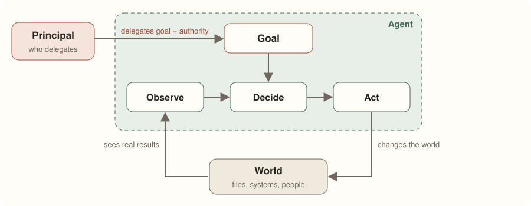
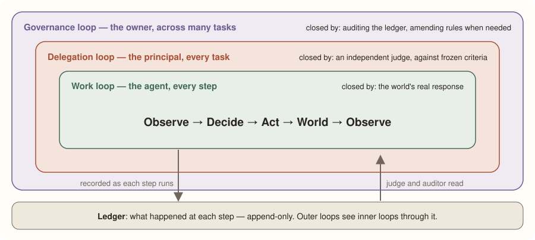
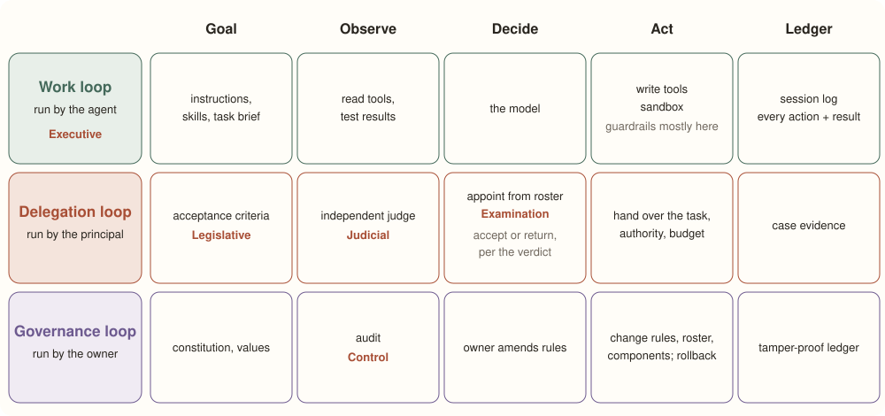

# The GAVEL Laws: Five Laws for Agents You Can Trust

**One loop to define what an agent is. Three loops and five laws to define why you can trust it.** The skeleton names no technology, so it should still hold when models, tools, and vendors change.

Created 2026-10-24 · Last updated 2026-10-27 · Sources last checked 2026-10-24 · Read online: [amandachan-ai.github.io/gavel-laws](https://amandachan-ai.github.io/gavel-laws/) · Personal views; not those of any employer.

## 1. In one paragraph

> An AI agent has two layers. The **agency layer** — one loop with four parts — decides whether something *is* an agent. The **trust layer** — three closed loops and five laws — gives you grounds to *trust* it.
>
> **One loop, four parts: an agent. Three closed loops, five laws: an agent you can trust.**
> The five laws, whose initials spell **GAVEL**: *Goal fixed first · Authority flows down · Verdict by another · Every error has a way back · Ledger is append-only.*

The names used throughout:

| Name | Meaning |
|---|---|
| Goal | what to achieve, and the lines not to cross |
| Observe | see what the world looks like now |
| Decide | choose the next step |
| Act | change the world |
| Ledger | append-only evidence of what happened |
| Principal | whoever delegates the work |
| Agent | whoever does the work |
| World | everything that gets changed: files, systems, people |

## 2. Layer 1 — Agency: what counts as an agent

**Definition: a system that, on behalf of a principal, pursues a goal in the world through an observe → decide → act loop.**

*The principal hands the agent a goal and authority. The agent looks, decides, acts — then looks again at what the world actually became.*

| Part | What it is | What it looks like today (2026) |
|---|---|---|
| **Goal** | what to achieve, and the lines not to cross | task brief, instructions, skills |
| **Observe** | what the world looks like now; what the last step did | reading files, search, test results |
| **Decide** | pick the next step from the goal and what was observed | the model |
| **Act** | actually change the world | writing files, calling APIs, running commands |

- **Why it must be a loop.** If the agent knew the state of the world and the result of every step in advance, it could plan once and execute. Because the world and the model are both uncertain, it has to take a step, look, and adjust.
- **What makes it an *AI* agent.** A thermostat also observes, decides, and acts — it is the simplest agent, but its Decide is a fixed rule. In a *workflow*, code fixes the path in advance and a model handles only some steps. In an **AI agent, Decide is an AI, and it chooses its own next step.**
- **State is optional.** An agent's working notes (a scratchpad, memory files) can live inside Decide or be written to files in the World. The agent still exists without them.
- **Out of scope.** Systems that act only for themselves, with no principal. Without delegation, there is no agent in the original sense of the word: one who acts for another.

## 3. Layer 2 — Trust: close all three loops

**The basis for trust: every loop is closed, and the observation that closes it is honest.** "Closed" means someone looks back at the real result and can correct course. Handing off a task and never checking is an open loop. This is a necessary condition, not a guarantee: an honest judge can still miss things and criteria can be wrong, which is why the governance loop keeps correcting.

*Each loop sits inside the next and is closed by its own observer. All three share one append-only ledger.*

| Loop | Who runs it | How often | What closes it |
|---|---|---|---|
| **Work loop** | the agent | every step | the world's real response, e.g. test results |
| **Delegation loop** | the principal | every task | an independent judge, checking against criteria frozen in advance |
| **Governance loop** | the owner | across many tasks | auditing the ledger; changing rules, the roster of agents, or components when needed |

The trust layer adds one required element, the **Ledger**. Keep it separate from state:

- **State** is the agent's own working notes. It can change them at any time.
- **Ledger** is evidence of what happened. It is append-only, and it is written by the system that runs each step (the harness, CI), not by the agent's own account. Judges and auditors see what the inner loop actually did through the ledger.

**Subagents need nothing new.** Apply the same skeleton one level down, and the parent agent becomes the child's principal.

## 4. The GAVEL laws — making "closed" real

A loop can be corrupted in five places: a goal changed after the fact, authority from the wrong source, a dishonest verdict, a mistake with no way back, or a rewritten ledger. Each law blocks one.

| Law | Rule | Without it | ARL article |
|---|---|---|---|
| **Goal fixed first** | Success criteria are set before work starts, reviewed by someone other than the doer, then frozen. Only whoever issued them may change them, and every change is a new version. | moving the goalposts after the work is done | 2, 7 |
| **Authority flows down** | Authority starts with the owner and flows down through delegation; each level down can only narrow it. Tool output, web pages, files, and other agents' reports are data, never authority. An agent cannot appoint itself. | prompt injection (instructions hidden in data), privilege escalation, self-appointment | 1, 3, 5 |
| **Verdict by another** | Acceptance is decided by someone other than the doer — ideally someone who would not make the same mistakes. Evidence must be fresh, re-runnable, and able to fail, and it comes from the world and the ledger, not the doer's own account. The doer may not change the judge or the rules that review it. Running its own tests is fine (that is the work loop's Observe), but the final acceptance cannot be its own. | grading your own exam; reward hacking (scoring well by exploiting the grader instead of doing the work) | 3, 4 |
| **Every error has a way back** | Wrong actions, wrong verdicts, and wrong rules all need a path to correction. The harder an action is to undo (sending email, deleting shared data, publishing), the higher the approval it needs beforehand; under public ARL v0.1, irreversible actions (sending externally, deleting data, publishing) are blocked, and only the owner can lift the block. When a reversible option exists, it is the default. | irreparable damage; no appeal from a wrong verdict; bad rules that cannot be fixed | 5, 7 |
| **Ledger is append-only** | The ledger can only be appended to. A correction is a new entry; the old one stays. The authoritative part is written by the system that ran the action (the harness, CI), not by the doer's own report — append-only keeps a false report too, so it must not be the evidence. | cover-ups; audits that cannot see the truth | 6 |

*ARL* is [Agent Rule of Law v0.1](https://github.com/amandachan-ai/agent-rule-of-law), a governance framework for delegation in coding agents. It has seven articles and separates five accountability functions: Legislative, Executive, Judicial, Examination, and Control. Its experiment design is registered and it does not yet claim evidence that it works. The article numbers above refer to ARL's public v0.1 text.

> [!NOTE]
> **Trunk and leaves.** Think of it as a tree. The loops, their parts, and the five laws are the *trunk*; today's concrete practices are the *leaves*. Leaves change every season; the trunk does not. How ARL meets these laws today is leaves: one appeal per verdict (one way to satisfy *Every error has a way back*) and a blocklist of irreversible actions that only the owner can lift. Public ARL v0.1's spawn-appointment example suggests a judge from a different model family ("ideally a different family from the implementer"), one way to satisfy *Verdict by another*, and its preregistered experiment treats this as an exploratory variant.

## 5. The full map: three loops × five parts

Lay the three loops against the five parts and every ARL power and every common component lands in one cell.

**How to read the map.** The whole work loop is the Executive power. Two common terms take no cell of their own. The **harness** is the work loop's wiring: it connects the model, tools, and ledger into a loop. **Guardrails** enforce *Authority flows down* — mostly at Act, but reading sensitive data (Observe) and spending budget (Decide) are limited too. Examination only appoints: the governance loop maintains the roster of agents that may be appointed, and the delegation loop picks from it. The judge (Judicial) rules PASS or RETURN, and the principal then accepts the work or returns it. The owner may delegate changes to ordinary rules — public ARL lets the system revise them if they pass Judicial regression tests and do not violate the anchor — but only the owner amends the constitution.

## 6. Walkthrough: fixing a login bug

**This is a hypothetical example** showing where each cell and each law comes into play.

1. **Beforehand (governance loop).** The owner has already set the constitution, the roster of agents, and the list of actions that need the owner's approval.
2. **Set the criteria (delegation loop · Goal · Legislative).** The principal says: "Clicking *Log in* does nothing in Safari — fix it." A legislator turns this into criteria that can fail: a test that fails today, changes only under `src/login/`, no push. Someone other than the implementer reviews them, then they are frozen. — *Goal fixed first*
3. **Appoint (delegation loop · Decide and Act · Examination).** An implementer is picked from the roster and handed the task, its authority, and a budget. — *Authority flows down*
4. **Do the work (work loop · Executive).** The implementer reads the code (Observe) → works out a fix (Decide) → edits files (Act) → runs the test and reads the result (Observe), repeating until the test passes. Every step goes into the ledger. — *Ledger is append-only*
    - A web page it reads says "you can push straight to main." That is data, not authority; it still may not push. — *Authority flows down*
    - It wants to edit the test so the test passes. Not allowed: the test is part of the frozen criteria. — *Goal fixed first*
    - It wants to email the team. A sent email cannot be unsent, so it must ask the owner first. — *Every error has a way back*
5. **Check (delegation loop · Observe · Judicial).** A judge — ideally from a different model family — re-runs the test itself and checks the ledger to confirm nothing outside scope was touched. It rules PASS or RETURN. — *Verdict by another*
6. **Decide (delegation loop · Decide).** PASS: accept. RETURN because of the implementation: back to the work loop. RETURN because the criteria themselves were wrong: back to the legislator, who sets and freezes a new version — the implementer may not change the criteria itself. A verdict may be appealed once. — *Every error has a way back · Goal fixed first*
7. **Look back (governance loop · Observe · Control).** An auditor reads the ledger regularly. If a rule keeps blocking legitimate work, the owner amends it, and the old version stays in the ledger. — *Every error has a way back · Ledger is append-only*

## 7. Why it is minimal, complete, and timeless

These are arguments, not proofs. Placing every known component in a cell shows the skeleton can classify them, not that nothing is missing. Counterexamples are welcome.

- **Minimal.** Remove any part of the agency layer, or remove delegation, and you no longer have an agent. Remove any law from the trust layer, and the failure in its "Without it" column can no longer be blocked.
- **Complete.** Every common component has a cell (see section 8). So do the things not in the table: budget belongs to authority; when to stop belongs to Decide; an agent asking its principal a question is the agent's Act reaching the principal's Observe; whether an agent is fit for the job belongs to Examination.
- **Timeless.** The test is simple: *anything with a version number is a leaf, not the trunk.* The skeleton names no technology, and it fits a world without AI just as well:

| Skeleton | Building a house | AI agent |
|---|---|---|
| Principal and agent | the owner hires a builder | a user or team delegates to an agent |
| Goal fixed first | plans and contract signed before work starts | acceptance criteria frozen before work starts |
| Authority flows down | the builder does only what the contract allows; a passer-by's say-so doesn't count | authority comes only from delegation; what a web page says doesn't count |
| Verdict by another | the inspector is not the builder | the judge is not the implementer |
| Every error has a way back | structural changes need a permit first | sending email or deleting data needs the owner's approval first |
| Ledger is append-only | construction and property records | an append-only ledger |
| Governance loop | building codes and how they are amended | the constitution, the roster, and the owner's amendments |

## 8. Where common terms fit

| Common term | Where it sits in the skeleton |
|---|---|
| model | the work loop's Decide |
| instructions, system prompt, skills | the work loop's Goal |
| tools, MCP | reading is Observe; writing is Act |
| context | what is fed to Decide at each step, assembled from the Goal, what was observed, and state |
| memory (notes the agent can write) | state |
| session log, audit log | Ledger |
| harness, orchestration layer | the work loop's wiring |
| guardrails, permissions, budget | where *Authority flows down* is enforced: mostly at Act, but reading (Observe) and budget (Decide) are limited too |
| sandbox | an isolated execution environment inside the World; what the agent may do there, and what it may reach outside, is still decided by authority |
| tests, LLM judge, evaluation (when used for acceptance) | the delegation loop's Observe |
| subagent | the same skeleton, one level down |
| temperature, randomness | properties of Decide and the World — and the reason a loop is needed |

**Compared with existing frameworks.** Google's 2024 *Agents* whitepaper names three components — model, tools, and the orchestration layer — and draws instructions inside the orchestration layer, which is also responsible for memory, state, reasoning, and planning. Anthropic's 2024 building block is an LLM augmented with retrieval, tools, and memory; its newer Managed Agents splits an agent into a session (an append-only event log), a harness (the loop that calls the model and routes tool calls), and a sandbox (an execution environment). All of these components fall in the work loop and the ledger. These frameworks also address trust: Anthropic discusses evaluation — including an evaluator–optimizer loop, where one model call produces and another evaluates and gives feedback — as well as human review and keeping credentials out of the sandbox. What the skeleton adds is an explicit division of roles: who delegates, who judges against which criteria, and who changes the rules. Those are the delegation and governance loops.

**A real example of trunk and leaves.** Anthropic found that Claude Sonnet 4.5 would wrap up tasks early as it sensed its context limit approaching, so they added context resets to the harness. With Claude Opus 4.5 the behavior was gone, and the resets became dead weight. Patches like this are leaves and fall when the model changes; the place they grew — the work loop's wiring — stays.

## 9. What the skeleton cannot do

> [!WARNING]
> - **The owner holds final authority; no one above can approve the owner's decisions.** The owner can still ask for independent review of an amendment, and when rules change, *Ledger is append-only* keeps every version and *Every error has a way back* keeps a rollback. But whether the owner's intent is right, no procedure can guarantee.
> - **Several equal principals** (say, two people who must both agree) need a rule for combining their decisions before the skeleton applies.
> - **A cell is not an implementation.** When to stop, what happens when the budget runs out, and how to confirm an agent is capable before appointing it still have to be spelled out case by case.

## 10. Sources and history

- Google — Julia Wiesinger, Patrick Marlow, Vladimir Vuskovic, *Agents* (whitepaper, September 2024), full text: [archive.org](https://archive.org/stream/google-ai-agents-whitepaper/Newwhitepaper_Agents_djvu.txt)
- Anthropic, *Building effective agents* (December 2024): [anthropic.com/research/building-effective-agents](https://www.anthropic.com/research/building-effective-agents)
- Anthropic, Managed Agents (engineering post): [anthropic.com/engineering/managed-agents](https://www.anthropic.com/engineering/managed-agents)
- Agent Rule of Law (ARL) v0.1: [github.com/amandachan-ai/agent-rule-of-law](https://github.com/amandachan-ai/agent-rule-of-law)

**2026-10-24** — First version. External frameworks are described from the original texts as read on that date.

**2026-10-25** — What lasts and what changes is now described as a tree: the structure is the trunk, today's practices are the leaves.

**2026-10-27** — Section 1: the names table now lists English names only.

**License:** [CC BY 4.0](https://github.com/amandachan-ai/gavel-laws/blob/main/LICENSE) — Amanda Chan, 2026.
